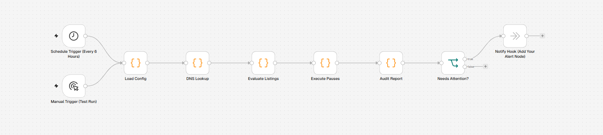

# n8n Outbound Domain Blacklist RBL Reputation Monitor

An n8n workflow that checks your secondary sending domains and dedicated sending IPs against DNS blacklists (RBLs) every 6 hours, and automatically pauses the matching Smartlead and/or Instantly campaigns when a listing is detected.

It is safe by default. Out of the box it makes no API calls that change anything, and DNS errors or timeouts can never cause a pause.

## How it works



```
Schedule (every 6h) ─┐
                     ├─> Load Config ─> DNS Lookup ─> Evaluate Listings ─> Execute Pauses ─> Audit Report ─> Needs Attention?
Manual trigger ──────┘
```

1. **Load Config** reads everything from environment variables and fails loudly on a broken configuration.
2. **DNS Lookup** queries each monitored target against each configured RBL zone. IPs are checked as reversed-octet lookups (`10.2.0.192.zen.spamhaus.org`) and domains as `domain.dbl.spamhaus.org`.
3. **Evaluate Listings** classifies every answer and produces one verdict per target.
4. **Execute Pauses** maps listed targets to campaigns, applies the safety guards, and either records what it would do (dry-run) or calls the Smartlead / Instantly pause endpoints with retries.
5. **Audit Report** outputs a complete, secret-free report of verdicts, actions, and warnings.
6. **Needs Attention?** routes to a placeholder node where you can attach Slack, email, or any alert node.

The same logic lives in one file, `lib/core.js`. `scripts/build-workflow.js` embeds it into the n8n Code nodes, and `mirror-cli.js` imports it. The workflow and the local mirror therefore make identical decisions.

## Safety model

| Safeguard | Behavior |
|---|---|
| Dry-run by default | `DRY_RUN=true` and `SANDBOX_MODE=true` are the defaults. Campaigns are only paused when **both** are `false`. |
| Fail-safe DNS | Timeouts, SERVFAIL, refused queries, and network errors are recorded as `error`. Errors never count as a listing. |
| Control code handling | RBL control answers such as `127.255.255.254` (resolver blocked) are treated as errors, not listings. |
| Hijack protection | Any answer outside `127.0.0.0/8` is treated as an error (protects against wildcard or hijacked DNS). |
| Circuit breaker | If a run would pause more than `MAX_PAUSES_PER_RUN` campaigns, nothing is paused. A mass listing usually means a resolver problem. |
| Primary domain guard | Domains in `PRIMARY_DOMAINS` are monitored and reported but never auto-paused. |
| Prefix guard | Optional `PAUSE_ID_PREFIX_ALLOW` limits pausing to campaign IDs with a given prefix, useful for staged rollout. |
| No secrets in output | API keys are read at call time, never stored in the workflow, and are redacted from error details. |

### Use isolated sending domains

Monitor secondary sending domains and dedicated IPs that are separate from your primary root domain. Cold outbound can damage reputation, and keeping it on isolated domains protects your main brand domain and its transactional and corporate mail. If you do monitor a primary domain, list it in `PRIMARY_DOMAINS` so it only raises alerts.

## Repository layout

```
.
├── workflow.json              n8n workflow (generated, import this)
├── mirror-cli.js              local mirror and simulator
├── lib/core.js                all decision logic (pure functions)
├── scripts/build-workflow.js  generates workflow.json from lib/core.js
├── fixtures/scenarios/        synthetic offline scenarios
├── test/                      unit, scenario, and hygiene tests
├── .env.example               documented configuration with safe placeholders
├── DISCLAIMER.md
├── LICENSE
└── package.json
```

There are no runtime dependencies. Node.js 18 or newer is required for the CLI and tests.

## Quick start (local, offline)

```bash
git clone <your-fork-url>
cd n8n-outbound-domain-blacklist-rbl-reputation-monitor
npm test
npm run simulate
npm run simulate:all
```

`npm run simulate` runs a scenario where one synthetic domain is listed. You will see the listing, the campaigns that would be paused, and no API calls.

## Install in n8n

1. Make sure your self-hosted n8n has these environment variables:
   - `NODE_FUNCTION_ALLOW_BUILTIN=dns` (the DNS Lookup node uses the Node.js `dns` module)
   - `N8N_BLOCK_ENV_ACCESS_IN_NODE=false` (the Code nodes read settings from `$env`)
2. Set the variables from `.env.example` on the n8n host. Keep `DRY_RUN=true` and `SANDBOX_MODE=true`.
3. In n8n, choose **Import from File** and select `workflow.json`.
4. Run the workflow with the **Manual Trigger (Test Run)** node and inspect the **Audit Report** output.
5. Activate the workflow when you are happy with the dry-run results. The schedule trigger then runs every 6 hours.

n8n Cloud does not allow built-in module access or environment variable access in Code nodes, so this workflow targets self-hosted n8n.

No n8n credentials are used. API keys come from environment variables, so the exported workflow contains no credential references, webhook IDs, or instance metadata.

## Configuration

All settings are environment variables. `.env.example` has a documented template.

| Variable | Default | Description |
|---|---|---|
| `DRY_RUN` | `true` | Safety switch. Must be `false` to pause anything. |
| `SANDBOX_MODE` | `true` | Second safety switch. Must also be `false` to pause anything. |
| `MONITORED_DOMAINS` | none | Comma separated sending domains. |
| `MONITORED_IPS` | none | Comma separated IPv4 addresses. |
| `PRIMARY_DOMAINS` | empty | Monitored but never auto-paused. |
| `RBL_ZONES` | built-in defaults | `[alias=]zone[:ip\|:domain]` entries, comma separated. |
| `MIN_LISTED_ZONES` | `1` | Number of zones that must list a target before it counts as listed. |
| `CAMPAIGN_MAP` | empty | JSON mapping targets to campaign IDs (see below). |
| `PAUSE_PLATFORMS` | `smartlead,instantly` | Platforms that may be paused. |
| `PAUSE_ID_PREFIX_ALLOW` | empty | Only campaign IDs starting with this prefix may be paused. |
| `MAX_PAUSES_PER_RUN` | `10` | Circuit breaker limit. |
| `SMARTLEAD_API_KEY` | none | Needed only in live mode. |
| `INSTANTLY_API_KEY` | none | Needed only in live mode. |
| `SMARTLEAD_BASE_URL` | `https://server.smartlead.ai` | https origin override. |
| `INSTANTLY_BASE_URL` | `https://api.instantly.ai` | https origin override. |
| `DNS_SERVERS` | system resolver | Comma separated IPv4 resolvers to use for RBL lookups. |
| `DNS_TIMEOUT_MS` | `4000` | Per-query timeout. |
| `DNS_CONCURRENCY` | `10` | Parallel DNS queries. |
| `HTTP_MAX_RETRIES` | `3` | Retries for 429, 5xx, and network errors. |
| `HTTP_RETRY_BASE_MS` | `1000` | Base delay for exponential backoff. |
| `HTTP_TIMEOUT_MS` | `15000` | Per-request timeout. |

## RBL zones

Default zones:

| Alias | Zone | Type | Notes |
|---|---|---|---|
| `spamhaus_zen` | `zen.spamhaus.org` | ip | Combined Spamhaus IP lists. Spamhaus refuses queries from many public or shared resolvers and returns `127.255.255.254`. Use your own recursive resolver, or the Spamhaus DQS service, and review their usage terms for your volume. |
| `spamhaus_dbl` | `dbl.spamhaus.org` | domain | Spamhaus domain blocklist. |
| `barracuda` | `b.barracudacentral.org` | ip | Barracuda reputation list. It generally requires registering the resolver IP you query from. |
| `sorbs` | `dnsbl.sorbs.net` | ip | Availability and policy of this service have changed over time. Confirm it still answers for you, and remove it from `RBL_ZONES` if it does not. |

Add or replace zones with `RBL_ZONES`. Each entry is `[alias=]zone[:ip|:domain]` and the type defaults to `ip`:

```
RBL_ZONES=spamhaus_zen=zen.spamhaus.org:ip,spamhaus_dbl=dbl.spamhaus.org:domain,custom=rbl.custom-zone.example:ip
```

If a zone name embeds a secret key (for example a Spamhaus DQS key), always give it an alias. Audit output uses the alias, never the raw zone name.

A zone only checks targets of its own type. IP zones check `MONITORED_IPS`, and domain zones check `MONITORED_DOMAINS`.

## Campaign mapping

`CAMPAIGN_MAP` is a single-line JSON object. Each key is a monitored domain or IP, and each value lists the campaign IDs to pause when that target is listed:

```json
{
  "send-1.outbound-pool.example": {
    "smartlead": ["zzz_TEST_sl_1001"],
    "instantly": ["zzz_TEST_inst_2001"]
  },
  "192.0.2.10": {
    "smartlead": ["zzz_TEST_sl_1002"]
  }
}
```

If several listed targets map to the same campaign, it is paused once and the audit report lists every reason. A listed target with no mapping is reported with the note `no_campaigns_mapped`.

## Verdicts

| Verdict | Meaning | Pauses? |
|---|---|---|
| `listed` | At least `MIN_LISTED_ZONES` zones returned a valid listing code. | Yes (live mode only) |
| `warning` | Listed on some zones, but fewer than `MIN_LISTED_ZONES`. | No |
| `clean` | All checks answered and none listed it. | No |
| `clean_partial` | Not listed anywhere, but at least one zone had a DNS error. | No |
| `unknown` | Every check failed or no zone applied. | No |

## Auto-pause behavior

When a target is `listed`, the workflow collects its mapped campaigns, removes duplicates, applies the guards (primary domain, platform filter, prefix guard, circuit breaker), and then:

- **Dry-run or sandbox:** records `dry_run` for each campaign it would pause. No HTTP requests are made.
- **Live:** sends one pause request per campaign.
  - Smartlead: `POST {SMARTLEAD_BASE_URL}/api/v1/campaigns/{id}/status` with `{"status":"PAUSED"}`, authenticated with the `api_key` query parameter.
  - Instantly: `POST {INSTANTLY_BASE_URL}/api/v2/campaigns/{id}/pause`, authenticated with a Bearer token.
  - Retries use exponential backoff on 429, 5xx, and network errors. Other 4xx responses fail immediately.
  - Missing credentials produce `skipped_missing_credentials` and no request.

Vendor APIs change. Check these endpoints against the current Smartlead and Instantly documentation before you enable live mode.

The workflow only pauses campaigns. It never resumes them. Resuming is a deliberate manual step after you have delisted the target and verified it is clean.

Possible action statuses: `dry_run`, `paused`, `failed`, `skipped_missing_credentials`, `blocked_circuit_breaker`.

## Dry-run vs live mode

| `DRY_RUN` | `SANDBOX_MODE` | Result |
|---|---|---|
| `true` | `true` | Dry-run (default) |
| `false` | `true` | Dry-run |
| `true` | `false` | Dry-run |
| `false` | `false` | **Live: campaigns are paused** |

Recommended rollout:

1. Run in dry-run for several days and review the audit reports.
2. Set `PAUSE_ID_PREFIX_ALLOW` to a prefix that only matches a few non-critical test campaigns.
3. Go live with both switches set to `false`.
4. Remove the prefix guard only when you trust the mapping.

## Audit output

Every run returns one item with:

- `mode` (`DRY_RUN` or `LIVE`) and `runAt`
- `summary` counts, including `needsAttention`
- `verdicts` per target, with listed zones and codes, and zones that had DNS errors
- `actions` per campaign with status, attempts, and a redacted detail message
- `notes` (for example `primary_domain_alert_only`, `no_campaigns_mapped`, `skipped_by_prefix_guard`)
- `configWarnings`

## Testing

```bash
npm test                    # unit tests, scenario tests, workflow sync check, repo hygiene scan
npm run simulate            # one listed domain, dry-run
npm run simulate:all        # every scenario
npm run simulate:live-mock  # live mode against a MOCK http layer (retries and failures)
npm run simulate:dns-failure
npm run check               # verify workflow.json matches lib/core.js
```

Scenario files in `fixtures/scenarios/` are fully synthetic. They use `.example` domains, `192.0.2.x` and `198.51.100.x` addresses, and `zzz_TEST_` campaign IDs. The mirror CLI mocks DNS and HTTP in scenario mode, so tests need no network.

The hygiene test fails the build if it finds a non-example email, an unexpected URL host, a public IP address, or a secret-looking string anywhere in the repository.

To run a read-only check against real DNS from your own machine:

```bash
cp .env.example .env     # then edit with your synthetic or real targets
npm run dns:check
```

This mode forces dry-run and never contacts Smartlead or Instantly.

### Changing the logic

Edit `lib/core.js`, then run `npm run build` to regenerate `workflow.json`, then `npm test`. The test suite fails if `workflow.json` is out of date.

## Extending

- Attach Slack, email, or ticketing nodes after **Notify Hook** to alert on `needsAttention`.
- Add more zones through `RBL_ZONES`.
- IPv6 and DNS-over-HTTPS are not implemented.

## Limitations

- Blacklist data is only as accurate as the operator's DNS responses.
- IPv4 only.
- A paused campaign stays paused until a human resumes it.
- This project does not warm up, rotate, or repair domains. It only detects and pauses.

## ⚠️ Disclaimer & Liability Limitation

**Use at your own risk.** The code, workflows, and scripts provided in this repository (n8n-outbound-domain-blacklist-rbl-reputation-monitor) are for educational and architectural demonstration purposes.

**No Liability:** The author and dhRobin Systems assume no responsibility or liability for any direct, indirect, incidental, or consequential damages resulting from the use, misuse, or deployment of these scripts and workflows.

**DNS Blacklist, Campaign Pausing & Outbound Infrastructure Risks:** Outbound automation carries inherent risks. Misconfigured domain or IP lists, incorrect campaign mappings, unreliable DNS resolvers, changed or unavailable blacklist responses, and bad or rate-limited API calls can produce false listings, pause campaigns that should keep running, fail to pause campaigns that should stop, exhaust API rate limits, or interrupt revenue-generating sending. DNS blacklist responses and third-party APIs (including Spamhaus, Barracuda, SORBS, Smartlead, Instantly, and n8n) may change or experience outages without notice. The DNS lookup stage only reads. The Execute Pauses stage writes to Smartlead and/or Instantly, and only when both `DRY_RUN=false` and `SANDBOX_MODE=false`.

**User Responsibility:** You are solely responsible for compliance with applicable laws, regulations, and contracts, including email and data-protection rules (such as CAN-SPAM, GDPR, CCPA, CASL, and PECR), the query usage policies of every blacklist operator you query, and the terms of service of Smartlead, Instantly, n8n, and any other provider you connect. You are also solely responsible for proper testing (`DRY_RUN=true` and `SANDBOX_MODE=true`) in a non-production environment, for verifying your configuration, and for assuming all risk before connecting any scripts to production environments or live campaigns.

Full text: [DISCLAIMER.md](DISCLAIMER.md) · Licensed under the [MIT License](LICENSE).

## License

MIT © 2026 dhRobin Systems · Provided as-is, see the disclaimer.
